  
  
  
  
  

### 🏀 Scouting report

Backend and AI engineer with internship and research experience in **retrieval-augmented generation (RAG)**, **AI agents**, **REST APIs** and **machine learning**. I like systems that are measured, not guessed: hybrid retrieval scored end to end, contract drift caught from real traffic, audits reconciled to the penny.

- 🏗️ Built **Shinrai**, a local AI workspace, and **ISHIZUE**, the plugin-first agent harness it runs on
- 🔬 Research at **IIIT Delhi** (5.6M+ eye-gaze records) and **IIT Roorkee** (spiking neural networks)
- 🎓 B.Tech ECE @ **University of Delhi** · Minor in AI/ML
- 🏆 Selected for **Amazon ML School 2026** (top 2% of candidates)

### ★ Player of the game

### 🎬 Highlight reel

<table>
  <tr>
    <td width="50%" valign="top">
      <b>🔒 ISHIZUE</b> · Jul – Sep 2026 
      Plugin-first agent orchestration harness under Shinrai: models, tools, skills and workflows load as composable plugins on Cordis. Built at ShristyVerse. 
      <code>TypeScript</code> <code>Cordis</code> <code>AI Agents</code> <code>Tool Calling</code>
    </td>
    <td width="50%" valign="top">
      <b><a href="https://github.com/anshgupta-456/apidocumentation">API Lens</a></b> · Jan – Mar 2026 · <a href="https://api-contract-validator.onrender.com/ui">live ▶</a> 
      Catches API contract drift from real traffic across 100+ endpoints, explains it with LLaMA 3.1 and drafts OpenAPI + Pydantic patches. 
      <code>FastAPI</code> <code>OpenAPI</code> <code>PostgreSQL</code> <code>Docker</code>
    </td>
  </tr>
  <tr>
    <td valign="top">
      <b><a href="https://github.com/anshgupta-456/spendsentinel">SpendSentinel</a></b> · Oct – Nov 2026 · <a href="https://anshgupta-456.github.io/spendsentinel/">live ▶</a> 
      Audit analytics on 51,417 UK government payments (£49.65bn): 17 data-quality rules, reconciled to the penny, 457 possible duplicate payments flagged in SQL, on a dashboard refreshed monthly. 
      <code>Python</code> <code>DuckDB</code> <code>SQL</code> <code>pandas</code>
    </td>
    <td valign="top">
      <b><a href="https://github.com/anshgupta-456/FitBudd">FitBudd</a></b> · Jun – Aug 2025 · <a href="https://fit-budd-ten.vercel.app">live ▶</a> 
      Computer-vision fitness coach: in-browser MediaPipe form checks for squats, push-ups and curls, plus plans, nutrition targets and partner matching. 
      <code>MediaPipe</code> <code>Next.js</code> <code>Flask</code> <code>SQLAlchemy</code>
    </td>
  </tr>
  <tr>
    <td valign="top">
      <b><a href="https://github.com/anshgupta-456/ripple">RIPPLE</a></b> · Sep – Oct 2026 
      AI teammate for merchant support: finds the earliest fixable cause, acts behind an action firewall, verifies closure. 44-case adversarial suite, zero unsafe actions. 
      <code>FastAPI</code> <code>React</code> <code>SSE</code> <code>OIDC</code>
    </td>
    <td valign="top">
      <b><a href="https://github.com/anshgupta-456/internoa">LLM Engineering Lab</a></b> · Oct – Nov 2026 
      LoRA / QLoRA fine-tune of Qwen2.5, RAG from scratch over RFC 6749 (bge-m3 + FAISS + BM25), and FP16 vs Q8 vs Q4 benchmarks in Ollama. 
      <code>PyTorch</code> <code>PEFT</code> <code>FAISS</code> <code>Ollama</code>
    </td>
  </tr>
</table>

<b>🏟️ Open gym — more builds and research</b>

 

| When | Project | What it is |
| --- | --- | --- |
| Aug&nbsp;–&nbsp;Sep&nbsp;2026 | 🔒 **RASP** | Shows naive anytime stopping in spiking networks under-covers (0.77 vs 0.90 on DSEC); alpha-spending restores validity |
| Jul&nbsp;–&nbsp;Aug&nbsp;2026 | [**Aayu OS**](https://github.com/anshgupta-456/aayu_os) | Produce shelf-life "OS" with a physics + vision filter and hash-chained ledger · HackNite Code Royale 2026 |
| Feb&nbsp;–&nbsp;Mar&nbsp;2026 | [**Geo-Sat**](https://github.com/anshgupta-456/geo-sat) | FastAPI + PostGIS disaster-response API with CNN-BiLSTM and Transformer models |
| Jan&nbsp;–&nbsp;Feb&nbsp;2026 | 🔒 **Software Bug Prediction** | Replicated a defect-prediction study on 8 NASA / PROMISE datasets, above 76% AUC on each |
| Jan&nbsp;–&nbsp;Feb&nbsp;2026 | [**SahAI**](https://github.com/anshgupta-456/sahai) | Classroom accessibility: blackboard OCR, Whisper notes, translation, offline on AMD ROCm |
| Dec&nbsp;2025&nbsp;–&nbsp;Jan&nbsp;2026 | 🔒 **Narrative Consistency Engine** | Claim-based LLM checks of character backstories against whole novels · Kharagpur Data Science Hackathon 2026 |
| Oct&nbsp;–&nbsp;Nov&nbsp;2025 | [**Commpiler-A**](https://github.com/anshgupta-456/Commpiler-A) | C-subset compiler: Flex/Bison, three-address IR with backpatching, register allocation, NASM x86 |
| Aug&nbsp;–&nbsp;Sep&nbsp;2025 | [**GG Nexus**](https://github.com/anshgupta-456/gg) · [live](https://gg-six-lime.vercel.app) | Full-stack gaming platform: tournaments, wallet, matchmaking, chat |
| Jul&nbsp;–&nbsp;Aug&nbsp;2025 | [**Zero-G Tracker**](https://github.com/anshgupta-456/Zero-G-Object-Tracker) | YOLOv8s space-station object detection, 85.3% mAP@0.5 · Build With India 2.0 |
| Mar&nbsp;–&nbsp;Apr&nbsp;2025 | [**Grievance Management System**](https://github.com/anshgupta-456/SEC-Project) · [live](https://grievance-hub-83u2.onrender.com/) | Team project: AI-routed student grievances; I rebuilt it end to end (JWT auth, admin workflow, new frontend, Render deploy) |

### 📋 Game log

| Qtr | Role | Project | When |
| :-: | --- | --- | --- |
| **Q4** | Backend Engineering Intern · **ShristyVerse** (Remote, Japan) | Shinrai + ISHIZUE · hybrid RAG, ~98.34% retrieval accuracy | Jul&nbsp;–&nbsp;Sep&nbsp;2026 |
| **Q3** | Research Intern · **IIIT Delhi** (Dr. Pragma Kar) | GazeBalance · 5.6M+ eye-gaze records, imbalanced classification | Jun&nbsp;–&nbsp;Aug&nbsp;2026 |
| **Q2** | Research Intern · **IIT Roorkee** | NeuroTree · spiking neural nets, 72.49% AUC on CIFAR-100 | May&nbsp;–&nbsp;Jul&nbsp;2026 |
| **Q1** | Research Intern · **IIIT Delhi** (Dr. Gaurav Ahuja) | Molecular modelling · ECFP6 vs GROVER on 10K+ PPI samples | May&nbsp;–&nbsp;Jul&nbsp;2025 |

### 🛠️ Starting five

   
   
   
  

  
  
  
  
  
  
  
  
  
  

### 🏆 Trophy case

- 🎓 **Amazon ML School 2026** — selected, top 2% of candidates
- 🚀 **AWS Bharat Startup Yatra** — Executive Core Team, CubeSanchar (featured)
- 🥈 **2nd place** — Masters' Union Startup Spotlight · DTU Code or Die
- 🥉 **3rd place** — Sankalp 101 Hackathon (TrishulX)

### 📊 On the stat sheet

  

  

  

<b>📈 Full metrics</b>

 

 

